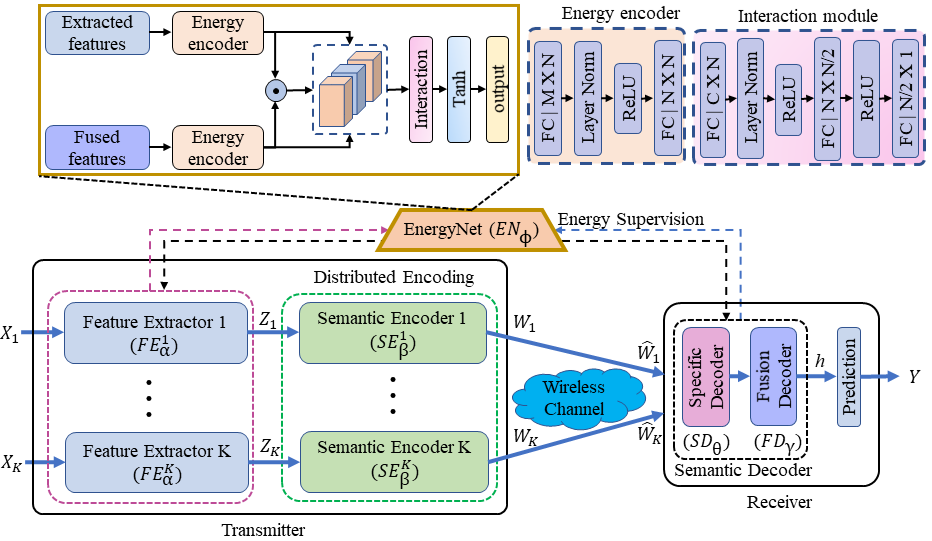

# Energy-Calibrated Task-Oriented Communication for Cooperative Multi-UAV Edge Inference

**Authors:** Exaud Tarimo†‡, Huanlai Xing†‡*, Lexi Xu§, Zonghai Zhu† and Li Feng†  
†School of Computing and Artificial Intelligence, Southwest Jiaotong University, Chengdu, China  
‡Engineering Research Center of Sustainable Urban Intelligent Transportation, Ministry of Education, Chengdu, China  
§Research Institute, China United Network Communications Corporation, Beijing, China  
**Corresponding Author:** Huanlai Xing  

*Code repository:* [ECSC-MUAV](https://github.com/exaud40/ecsc-muav)

---

## Proposed Architecture



---

## Repository Structure

```
ecsc-muav/
├── main.py                  
├── config.py                                                      
├── requirements.txt
├── data/
│   └── dataloader.py        
├── models/
│   ├── net.py               
│   ├── encoder.py           
│   ├── decoder.py           
│   ├── channel.py           
│   ├── views.py             
│   ├── energy.py            
│   └── feature_extractor.py 
└── utils/
    ├── train.py 
    ├── common.py                   
    ├── costs.py
    ├── eval_all.py
    ├── make_tables.py              
    └── plots.py            
```

---

## Datasets

| `--dataset`     | Dataset            | Classes | Split used                                              |
|-----------------|--------------------|---------|---------------------------------------------------------|
| `uc_merced`     | UC Merced Land Use | 21      | stratified 70 / 10 / 20 (train / val / test)            |
| `rsscn`         | RSSCN7             | 7       | stratified 70 / 10 / 20 (train / val / test)            |
| `nwpu_resisc45` | NWPU-RESISC45      | 45      | provided `train/` and `test/`; 10 % of `train/` for val |

Download the datasets from their official sources and arrange them as below. These are the default locations; use `--data_root <path>` to put them anywhere else.

```
data/
├── UCMerced_LandUse/Images/<class_name>/*.tif        # uc_merced
├── RSSCN7/<class_name>/*.jpg                         # rsscn
└── NWPU-RESISC45/
    ├── train/<class_name>/*.jpg                      # nwpu_resisc45
    └── test/<class_name>/*.jpg
```


## Get Started

Requires Python 3.10+ and PyTorch 2.1+.

```bash
git clone https://github.com/exaud40/ecsc-muav.git
cd ecsc-muav
pip install -r requirements.txt
```

---

## Usage

Run everything from the repository root. `--phase` selects what to run: `train`, `eval`, or `all` (default).

### Quick start: full pipeline on one dataset

```bash
python main.py --dataset uc_merced --variant ecsc --seed 0
```

### Reproducing the results

```bash
for ds in uc_merced rsscn nwpu_resisc45; do
  for variant in ecsc cosine_distill no_teacher; do
    for seed in 0 1 2; do
      python main.py --phase all --dataset $ds --variant $variant --seed $seed
    done
  done
done
python main.py --phase tables
```


---
## Citation

If you find this work useful, please cite:

```bibtex
@article{ecsc_muav_2026,
  title={Energy-Calibrated Task-Oriented Communication for Cooperative Multi-UAV Edge Inference},
  author={Tarimo, Exaud and Xing, Huanlai and Xu, Lexi and Zhu, Zonghai and Feng, Li},
  journal={TBD},
  year={2026}
}
```

## Contact

For questions or collaborations: exaudtarimo@my.swjtu.edu.cn

## Acknowledgement

This work is supported by the **Sichuan Science and Technology Program (2024NSFSC1472)**.
