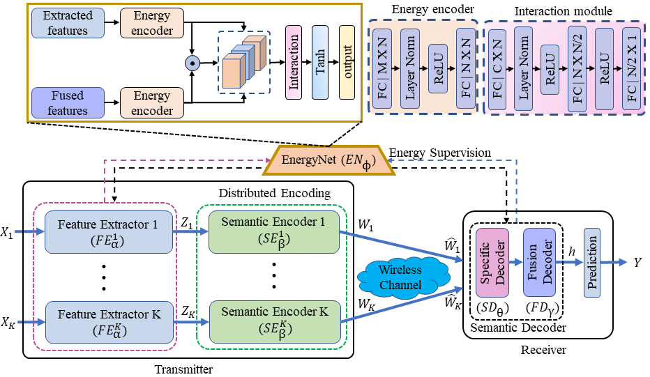

#  Energy-Calibrated Task-Oriented Communication for Cooperative Multi-UAV Edge Inference

## Authors

**Authors:** Exaud Tarimo†‡, Huanlai Xing†‡*, Lexi Xu§, Zonghai Zhu† and Li Feng†  
†School of Computing and Artificial Intelligence, Southwest Jiaotong University, Chengdu, China  
‡Engineering Research Center of Sustainable Urban Intelligent Transportation, Ministry of Education, Chengdu, China  
§Research Institute, China United Network Communications Corporation, Beijing, China  
**Corresponding Author:** Huanlai Xing  

*Code Repository:* https://github.com/exaud40/ECSC-MUAV

---

##  Overview

This repository provides the official implementation of:

> **Energy-Calibrated Semantic Communication for Multi-UAV (ECSC-MUAV)**

Multi-UAV systems are increasingly used for collaborative perception and real-time edge intelligence in next-generation wireless networks. However, transmitting high-dimensional data over bandwidth-limited and noisy channels introduces significant challenges.

ECSC-MUAV addresses this by introducing a **task-oriented semantic communication framework** that:
- Reduces redundant transmissions
- Preserves task-relevant semantic information
- Improves robustness under low SNR conditions
- Optimizes energy consumption for UAV systems

---

##  Key Features

-  **Lightweight Semantic Encoder**  
  Extracts compact and task-relevant representations from high-dimensional UAV observations.

-  **Energy-Based Calibration (EnergyNet)**  
  Enforces semantic alignment between transmitted and fused features using an energy-based model.

-  **Selective Retransmission Strategy**  
  Dynamically requests retransmission only for unreliable semantic components.

---

##  System Architecture



**Pipeline Overview:**
1. UAVs capture multi-view images  
2. CLIP-based feature extraction  
3. Lightweight semantic encoding  
4. Transmission over noisy wireless channel  
5. Edge server decoding + feature fusion  
6. Energy-based semantic calibration (EnergyNet)  
7. Task-specific inference  

---

##  Results

ECSC-MUAV demonstrates strong performance on remote sensing datasets:

###  Key Outcomes
-  **+4% ~ 7% accuracy improvement** under low SNR  
-  **Up to 18% reduction in energy consumption**  
-  Improved robustness to:
  - Channel noise  
  - UAV drop-out  
  - Bandwidth constraints  

###  Datasets
- **UC Merced Land Use**
- **RSSCN7**

---

##  Requirements

###  Environment
- Python 3.1x
- PyTorch 2.5.x

###  Dependencies

```
-NumPy
-Matplotlib
-Scikit-image
```

###  Install Packages

```bash
pip install torch torchvision transformers tqdm thop
```

---

##  Getting Started

```bash
git clone https://github.com/exaud40/ECSC-MUAV.git
cd ECSC-MUAV
```

*(Add training/inference scripts here when ready)*

---

##  Method Highlights

### 🔹 Energy-Calibrated Semantic Alignment
- Models semantic consistency using an **energy function**
- Lower energy → stronger alignment between UAV features

### 🔹 Selective Retransmission
- Confidence-driven stopping criterion
- Attention-based UAV scheduling
- Minimizes unnecessary communication

---

##  Citation

If you find this work useful, please cite:

```bibtex
@article{ecsc_muav_2026,
  title={Energy-Calibrated Task-Oriented Communication for Cooperative Multi-UAV Edge Inference},
  author={Tarimo, Exaud and Xing, Huanlai and Xu, Lexi and Zhu, Zonghai and Feng, Li},
  journal={TBD},
  year={2026}
}
```

---

##  Contact

For questions or collaborations:
- Email: exaudtarimo@my.swjtu.edu.cn  

---

##  Acknowledgement

This work is supported by:

- **Sichuan Science and Technology Program (2024NSFSC1472)**

